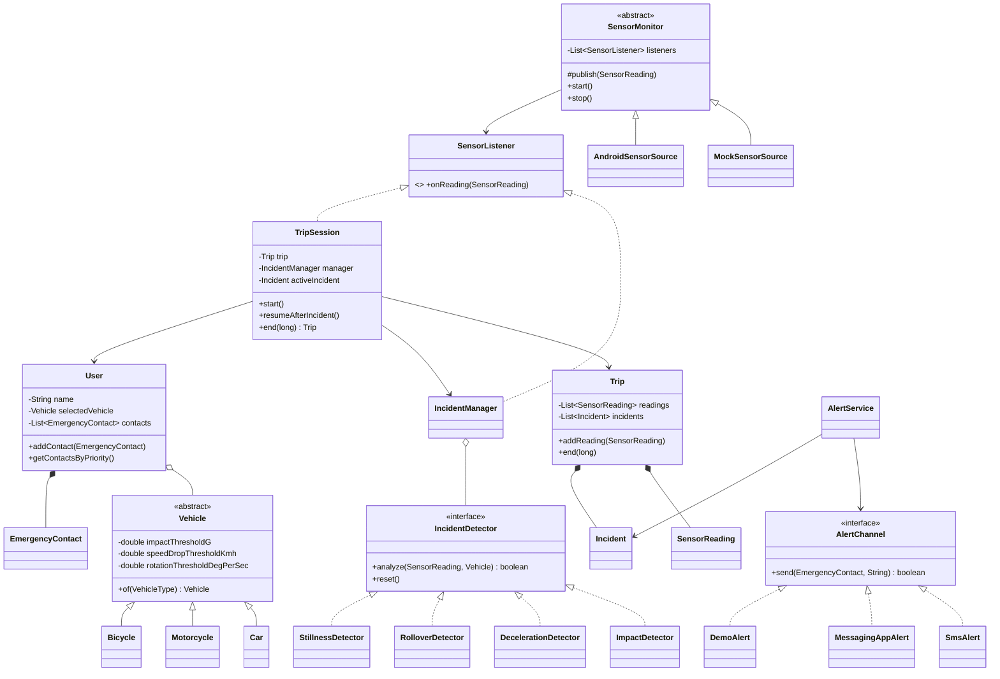

# Arquitetura do Guard

## Fluxo de uma leitura

```
MockSensorSource / AndroidSensorSource      (SensorMonitor, padrão Observer)
        │ publish(SensorReading)
        ├──► IncidentManager.onReading()
        │        │ para cada IncidentDetector (polimorfismo):
        │        │   ImpactDetector · DecelerationDetector · RolloverDetector · StillnessDetector
        │        │ regra: Impact AND SpeedDrop AND (Rotation OR Stillness)
        │        ▼
        │    TripSession.onIncidentDetected()  guarda o incidente ativo e o adiciona na Trip
        │        ▼
        │    TripActivity.onIncident() ──► AlertActivity (15 s, "I'm OK")
        │                                       │ pega o MESMO Incident da TripSession
        │                                       │ tempo acabou
        │                                       ▼
        │                                AlertService.start() ──► AlertChannel.send()
        │                                       │ sem resposta
        │                                       ▼
        │                                AlertService.escalate() ──► próximo contato
        ├──► Trip.addReading()               guarda velocidade máxima
        └──► TripSession.onReading() ──► TripActivity.onReading()   atualiza a tela
```

## Quem faz o quê

| Camada | Pacote | Depende do Android? | Responsabilidade |
| --- | --- | --- | --- |
| Domínio | `model`, `model/vehicle` | Não | Dados e regras (validação, estados do incidente) |
| Sensores | `sensor` | Só `AndroidSensorSource` | Produzir leituras (simuladas ou reais) |
| Detecção | `detection` | Não | Decidir se houve um possível acidente |
| Alertas | `alert` | Só `SmsAlert`/`MessagingAppAlert` | Avisar contatos e escalonar |
| Sessão | `session` | Não | Coordenar uma viagem em andamento |
| Dados | `data` | Sim | Salvar e ler do SQLite |
| Telas | `ui/*` | Sim | Mostrar e reagir a toques; nenhuma regra de negócio |

## Diagrama de classes



## Por que o domínio não usa Android

`model`, `sensor` (exceto `AndroidSensorSource`), `detection`, `session` e `alert` (exceto `SmsAlert` e `MessagingAppAlert`) são Java puro. Vantagens:

- os testes rodam no computador, sem emulador;
- trocar sensor real por simulado (ou SMS por demo) é trocar **uma** classe, graças às abstrações.
