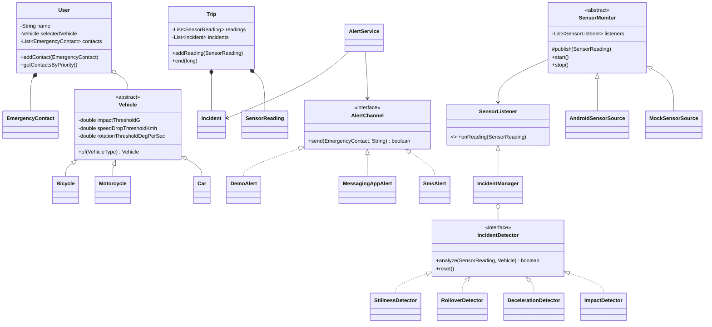

# Arquitetura do Guard

## Fluxo de uma leitura

```
MockSensorSource / AndroidSensorSource      (SensorMonitor, padrão Observer)
        │ publish(SensorReading)
        ├──► Trip.addReading()               guarda velocidade máxima
        ├──► TripActivity.render()           atualiza a tela
        └──► IncidentManager.onReading()
                 │ para cada IncidentDetector (polimorfismo):
                 │   ImpactDetector · DecelerationDetector · RolloverDetector · StillnessDetector
                 │ regra: Impact AND SpeedDrop AND (Rotation OR Stillness)
                 ▼
             IncidentListener ──► CountdownActivity (30 s, "I'm OK")
                                         │ tempo acabou
                                         ▼
                                  AlertService.start() ──► AlertChannel.send()
                                         │ sem resposta
                                         ▼
                                  AlertService.escalate() ──► próximo contato
```

## Diagrama de classes



## Por que o domínio não usa Android

`model`, `sensor` (exceto `AndroidSensorSource`), `detection` e `alert` (exceto `SmsAlert` e `MessagingAppAlert`) são Java puro. Vantagens:

- os testes rodam no computador, sem emulador;
- trocar sensor real por simulado (ou SMS por demo) é trocar **uma** classe, graças às abstrações.
